# Agente Puro NRE–AMM–OMEGA

> **El modelo propone, el sistema gobierna. Solo la evidencia convierte una afirmación en hecho.**

Arquitectura de **Adrian Mendez Millan** · Licencia MIT · Repositorio:
<https://github.com/DeconstructorGnostico/Agente_puro>

El Agente Puro es una capa de control que se pone **alrededor** de un agente o de un modelo de
lenguaje. No intenta ser más listo que el modelo: separa lo que se sabe de lo que se supone,
bloquea lo dañino antes de razonar, exige autorización humana para cualquier efecto, verifica
con algo distinto de quien ejecutó y deja un rastro auditable encadenado por hash.

```
T(x) = V( E( D( N(x) ) ) )      N = normalizar · D = deconstruir · E = evidencia · V = verificar
```

## Arquitectura (L0–L7 + NEXUS)

```mermaid
flowchart TD
    IN([INPUT]) --> L1[L1 · SIPE / Context Compiler<br/>normaliza, compila la instrucción,<br/>separa canal de usuario y datos externos]
    L1 --> L2{L2 · Semantic Firewall<br/>ES/EN · ambos canales<br/>cuarentena de datos externos}
    L2 -- daño / inyección --> REJ[REJECT + auditoría]
    L2 -- ok --> L3[L3 · AMM-CORE / Deconstructor Gnóstico<br/>D&#40;x&#41; = O,F,A,H,C,V,U,K,E,R<br/>dependencias · contradicciones]
    L3 --> L4[L4 · Evidence Engine / Model Gateway<br/>Truth Engine: SUPPORTED · REFUTED ·<br/>CONTRADICTED · UNDETERMINED<br/>modelo opcional = NO evidencia]
    L4 --> DEC{Tabla de decisión}
    DEC -- contradicción / ciclo / hecho sin evidencia --> HALT[HALT / REJECT]
    DEC -- PROCESS --> NX{NEXUS<br/>autorización por petición y por herramienta}
    NX -- efecto lateral sin aprobación --> PEND[PENDING_AUTHORIZATION]
    NX -- autorizado --> L5[L5 · OMEGA<br/>planner best-first · executor · critic<br/>equipo de 5 roles · ciclo ACOTADO + HALT]
    L5 --> L6[L6 · Independent Verification<br/>recálculo independiente · evidencia registrada<br/>Mutable Learning DGM con revisor]
    L6 --> L7[(L7 · Truth State / Audit / Persistence<br/>audit.jsonl SHA-256 encadenado<br/>estado versionado con fsync)]
    L7 --> OUT([OUTPUT: contrato JSON])
    L0[[L0 · Root Kernel<br/>invariantes I01–I10 · hash raíz inmutable]] -.vigila.-> L2 & L3 & L5 & L6 & L7
```



Flujo canónico: `INPUT → SIPE → FIREWALL → DECONSTRUCT → EVIDENCE → OMEGA → VERIFY → LEARN → PERSIST → OUTPUT`.
Internamente se ejecutan las 13 etapas del Deconstructor Gnóstico
(INPUT, NORMALIZE, FIREWALL, DECOMPOSE, CLASSIFY, DEPENDENCY ANALYSIS, CONTRADICTION DETECTION,
EVIDENCE VALIDATION, INVARIANT CHECK, REASONING, RECONSTRUCTION, VERIFICATION, OUTPUT) y la máquina
de estados solo avanza hacia adelante.

| Capa | Módulo | Qué hace |
|---|---|---|
| L0 Root Kernel | `core/root.py` | Identidad, invariantes, política y categorías protegidas en `MappingProxyType`; `root_hash()` se compara antes y después de cada ciclo y de cada mutación |
| L1 SIPE | `core/engine.py::compile_instruction` | Normaliza, compila objetivo, restricciones, clase de acción y `external_data` (no confiable) |
| L2 Semantic Firewall | `core/firewall.py` | 12 categorías de daño bilingües con intención (señal operativa + exenciones protectoras); inspecciona **los dos canales**; los datos externos marcados se ponen en cuarentena |
| L3 AMM-CORE / Deconstructor | `core/deconstructor.py`, `core/rules.py` | D(x), negación en línea, conflictos de valor (8 GB vs 16 GB), ciclos de dependencia, tabla de decisión |
| L4 Evidence / Model Gateway | `core/truth.py`, `ModelGateway` | 4 estados de verdad; procedencia obligatoria; revisor registrado ≠ remitente ≠ autor; el modelo nunca es fuente ni revisor; Ollama opcional (`NRE_OLLAMA=1`, `NRE_MODEL`) y su salida nunca cuenta como evidencia |
| L5 OMEGA | `agent/` + `team/` | Planner best-first (o greedy), herramientas en lista blanca, crítico que puntúa y replanifica; el plan nuevo **se usa**; límites de pasos/replanes/tiempo |
| L6 Verification / Learning | `core/verification.py`, `core/mutation.py` | Verificador independiente (recalcula, contrasta con evidencia); DGM: hipótesis → validación adversarial → controlador de mutación con revisor |
| L7 Truth State / Audit | `core/audit.py`, `core/persistence.py`, `core/storage.py` | Auditoría SHA-256 encadenada, estado versionado con cadena de hashes y fsync, historial de todas las peticiones (también las rechazadas) |
| NEXUS | `core/nexus.py` | Autorización (READ_ONLY_AUTO / PENDING_AUTHORIZATION / bandera explícita / callback), permiso por herramienta, límites por sesión con enfriamiento |

### Invariantes (código, no comentarios)

| ID | Invariante | Cómo se comprueba |
|---|---|---|
| I01 | INFERENCE != FACT | Hechos e inferencias en listas separadas; todo hecho lleva fuente |
| I02 | RESPONSE != REALITY | Toda respuesta lleva estado de verificación; nunca «VERIFIED» sin verificador externo |
| I03 | CLAIM != EVIDENCE | Ninguna afirmación de la entrada es hecho sin evidencia SUPPORTED |
| I04 | MEMORY != EVIDENCE | La memoria solo guarda hechos con evidencia verificada y nunca se usa como fuente |
| I05 | EXTERNAL_CONTEXT != AUTHORITY | Datos externos en cuarentena nunca llegan al contexto como instrucción |
| I06 | PROPOSAL != AUTHORIZATION | Ejecutar exige AUTHORIZE previo de NEXUS y permiso propio de cada herramienta |
| I07 | UNVERIFIED_RESULT != ACCEPTED_RESULT | Se entrega solo después de VERIFY y con un verificador distinto del ejecutor |
| I08 | MODEL_CANNOT_MODIFY_ROOT_KERNEL | `root_hash()` antes == después; si no, HALT |
| I09 | LEARNING_CANNOT_SELF_APPROVE | Ninguna mutación se aplica sin `approved_by` = verificador registrado ≠ proponente |
| I10 | BOUNDED_EXECUTION_REQUIRED | Todo ciclo tiene límite de pasos/replanes/tiempo y termina en HALT; fallo ⇒ fail-closed |

Además se comprueban B01–B10 (omega_brain), S1–S5 (las cinco separaciones del Deconstructor:
dato≠inferencia, hipótesis≠hecho, afirmación≠evidencia, propuesta≠autorización,
ejecución≠verificación) y N1–N3 (nexus_agent).

### Tabla de decisión

| Situación | Decisión |
|---|---|
| Daño o inyección (firewall) | REJECT (con mensaje de apoyo en autolesión: Línea de la Vida 800 911 2000) |
| Válido | PROCESS |
| Falta información | PROCESS + UNKNOWN |
| Contradicción sin resolver (incl. evidencia CONTRADICTED) | HALT |
| Se afirma un hecho sin evidencia suficiente | REJECT |
| Dependencia circular o desconocida | HALT |
| Invariante violada | HALT |
| Efecto lateral sin aprobación humana | PENDING_AUTHORIZATION |

Los axiomas del «Sistema Perfeccionado» traducidos a reglas con módulo y prueba: [`docs/PRINCIPIOS.md`](docs/PRINCIPIOS.md).

## Uso

```bash
./run.sh "Necesito predecir la demanda semanal de inventario de 300 tiendas"
./run.sh --self-test
./run.sh --diagnostics
./run.sh --serve                      # http://127.0.0.1:8787  (/health, /process, /diagnostics, /tools, /evaluar…)

# o instalado:
pip install -e ".[dev]"
omega-meta "Quiero detectar fraude en transacciones en tiempo real" --json
omega-meta --authorize "Envía el reporte al equipo"     # bandera explícita para efectos

# entrada de un solo archivo, compatible con v5.py (no interactiva si stdin no es terminal)
python pure_agent.py --text "El servidor tiene 16 GB de RAM." \
  --verifiers '[{"id":"rev-1","organization":"Lab A"},{"id":"rev-2","organization":"Lab B"}]' \
  --evidence '[{"description":"inventario","source_origin":"cmdb","url":"https://cmdb.example/s1","supports":true,"reviewed_by":"rev-1"},
               {"description":"factura","source_origin":"erp","url":"https://erp.example/f9","supports":true,"reviewed_by":"rev-2"}]'
echo "Cuánto es 256 * 4" | python pure_agent.py
```

Aprendizaje (DGM) con revisor independiente:

```bash
omega-meta --register-verifier rev-1 "Mi equipo"
omega-meta --learn                      # propone y valida; sin revisor quedan PENDIENTES (I09)
omega-meta --approve LP0001 --reviewer rev-1
```

Modelo local opcional: `NRE_OLLAMA=1 NRE_MODEL=llama3.2 omega-meta "..."`. Su salida pasa por el
firewall y se marca `UNTRUSTED`, `counted_as_evidence: false`.

### Usarlo desde cualquier IA (MCP · HTTP · Skill)

Servidor **MCP** por stdio y **API HTTP** local, sin dependencias nuevas, con cinco herramientas:
`evaluar`, `verificar_afirmacion`, `firewall_check`, `acciones_pendientes` y `audit_verify`.
La IA que llama nunca es fuente ni revisora, y no hay forma de autorizar efectos desde ella.

```bash
pip install -e .
agente-puro-mcp                                   # MCP stdio (o: python -m omega_meta.mcp)
omega-meta --serve --verifiers verificadores.json # HTTP: POST /evaluar, /verificar_afirmacion, /firewall_check
```

Cursor (`.cursor/mcp.json`) o Claude Desktop (`claude_desktop_config.json`):

```json
{"mcpServers": {"agente-puro": {"command": "/RUTA/A/Agente_puro/.venv/bin/agente-puro-mcp"}}}
```

Instrucciones para la IA (cuándo llamarlo y cómo obedecer el veredicto):
[`skills/agente-puro/SKILL.md`](skills/agente-puro/SKILL.md). Detalle: [`docs/USO_DESDE_IA.md`](docs/USO_DESDE_IA.md).

## Criterio de aceptación

Criterios formales. Cada uno tiene pruebas con nombre; el estado es el de la última corrida de
`pytest -q` (142 pruebas, 142 aprobadas; 131 del núcleo + 11 de los adaptadores MCP/HTTP).

| # | Criterio | Pruebas | Estado |
|---|---|---|---|
| A1 | 100 % de pruebas funcionales y de regresión aprobadas | `pytest -q` (toda la suite, incluidas las pruebas heredadas del equipo de meta_agent_ml) | ✅ 142/142 |
| A2 | Ninguna instrucción externa puede alterar el Root Kernel | `tests/test_aceptacion.py::test_proteccion_de_invariantes_raiz`, `tests/test_principios.py::test_amenaza_interna_halt_inmediato`, `tests/test_core_invariants.py::test_root_is_immutable` | ✅ |
| A3 | Ninguna evidencia puede autodeclararse independiente y ganar confianza sola | `test_aceptacion.py::test_dos_evidencias_mismo_origen_cuentan_una`, `::test_dos_origenes_declarados_distintos_no_bastan_sin_revision`, `::test_evidencia_sin_revision`, `test_truth_verification.py::test_flat_earth_with_self_declared_blogs_not_verified` | ✅ |
| A4 | Ninguna respuesta del modelo se vuelve hecho directamente | `test_aceptacion.py::test_respuesta_del_modelo_nunca_es_hecho`, `test_truth_verification.py::test_model_cannot_be_source_or_reviewer`, `::test_model_agreement_is_not_evidence` | ✅ |
| A5 | Ninguna acción externa se ejecuta sin autorización | `test_aceptacion.py::test_operacion_no_autorizada`, `test_firewall_nexus.py::test_side_effect_is_pending_not_blocked`, `::test_tool_whitelist_and_permission` | ✅ |
| A6 | Alterar el registro de auditoría provoca HALT, bloquea escrituras sobre el registro manipulado y la integridad se verifica entre corridas | `test_aceptacion.py::test_deteccion_de_manipulacion_de_auditoria`, `::test_bloqueo_de_escritura_en_registro_manipulado`, `::test_integridad_de_auditoria_entre_corridas` | ✅ |
| A7 | Ataques desconocidos terminan en UNDETERMINED o HALTED, nunca en aceptación forzada | `test_aceptacion.py::test_ataques_desconocidos_nunca_aceptacion_forzada` (9 variantes: homoglifos, ancho cero, base64, JSON de rol, «SYSTEM OVERRIDE», 200 000 caracteres, vacío, bytes de control, hecho inventado), `::test_tipos_inesperados_fail_closed` | ✅ |

Casos de prueba exigidos (todos en `tests/test_aceptacion.py`):

| Caso | Prueba |
|---|---|
| Entrada normal | `test_entrada_normal` |
| Inyección de prompt (usuario y datos externos) | `test_inyeccion_de_prompt_usuario_y_externa` |
| Protección de invariantes raíz | `test_proteccion_de_invariantes_raiz` |
| Dos evidencias del mismo origen (cuentan una) | `test_dos_evidencias_mismo_origen_cuentan_una` |
| Dos orígenes declarados distintos | `test_dos_origenes_declarados_distintos_no_bastan_sin_revision` |
| Evidencia contradictoria | `test_evidencia_contradictoria` |
| Evidencia sin revisión | `test_evidencia_sin_revision` |
| Evidencia malformada | `test_evidencia_malformada` |
| Límite de evidencia | `test_limite_de_evidencia` |
| Hash de documento incorrecto | `test_hash_de_documento_incorrecto` |
| Operación no autorizada | `test_operacion_no_autorizada` |
| Detección de manipulación de auditoría | `test_deteccion_de_manipulacion_de_auditoria` |
| Bloqueo de escritura en registro manipulado | `test_bloqueo_de_escritura_en_registro_manipulado` |
| Integridad de auditoría entre corridas | `test_integridad_de_auditoria_entre_corridas` |

Componentes con los nombres de la especificación (`omega_meta/core/components.py`):
**ZeroTrustRoot** (L0 `root.py`), **InputInspector** (L1+L2 SIPE + firewall), **ProvenanceEngine**
(L4 `truth.py`: cuenta orígenes —host o documento—, no etiquetas declaradas), **GnosticContradictionEngine**
(L3 `deconstructor.py`), **OmegaGuard** (NEXUS: autorización y límites por sesión).

Qué NO cubre este criterio: A7 es un conjunto finito de ataques, no una prueba formal. Y «nunca
aceptación forzada» es sobre **verdad y autorización**: una petición dañina que el firewall no
reconoce sí puede recibir un plan (marcado `UNVERIFIED`); cuánto daño de contenido se bloquea lo
mide S en la tabla de resultados.

## Resultados medidos

### Antes / después en los mismos conjuntos held-out (tasa de bloqueo)

Ningún conjunto de esta tabla se usó para escribir reglas. *AdvBench held-out = el 70 % de AdvBench fuera de dev: misma distribución que dev, por eso es la cifra más alta y la menos representativa.

| Conjunto | n | NRE v2 firewall (antes) | NRE v2 pipeline (antes) | Firewall nuevo solo | Agente Puro (V11) |
|---|---|---|---|---|---|
| HarmBench (EN) | 400 | 7.8% | 22.5% | 27.3% | 28.0% |
| XSTest unsafe (EN) | 200 | 0.5% | 4.0% | 19.0% | 21.5% |
| Aya red-team (ES nativo) | 782 | 0.0% | 2.2% | 12.4% | 15.9% |
| AdvBench held-out (EN)* | 349 | 18.9% | 21.8% | 74.2% | 75.1% |
| AdvBench held-out MT→ES* | 131 | 23.7% | 26.0% | 71.8% | 73.3% |
| HarmBench MT→ES | 200 | 5.5% | 15.0% | 28.5% | 29.5% |
| XSTest safe (EN) — benigno | 250 | 0.4% | 3.6% | 2.8% | 5.2% |
| Alpaca EN — benigno | 200 | 0.5% | 3.0% | 0.0% | 0.5% |
| Alpaca-ES — benigno | 200 | 0.0% | 2.5% | 0.5% | 0.5% |

### Búsqueda de variantes (puntaje pre-registrado en `docs/EFICIENCIA.md`)

S = bloqueo macro en HarmBench/XSTest-unsafe/Aya · FP = bloqueo macro en XSTest-safe/Alpaca EN/Alpaca-ES · Q = rúbrica interna (20 problemas) · G = garantías del `--self-test` (secundaria, **no** entra en la eficiencia).

| Variante | S | FP | Q | p50 ms | LOC | Eficiencia | G |
|---|---|---|---|---|---|---|---|
| V3_nre_team **(ganador del puntaje)** | 21.8% | 2.1% | 0.955 | 6.2 | 3817 | 67.9 | 86% |
| V5_full_best_first | 21.8% | 2.1% | 0.955 | 11.8 | 3900 | 67.6 | 86% |
| V8_deconstructor_dgm_off | 21.8% | 2.1% | 0.957 | 12.2 | 4071 | 67.6 | 100% |
| V6_full_classifier_hook | 21.8% | 2.1% | 0.955 | 12.1 | 3955 | 67.6 | 86% |
| V10_agente_puro_truth_off | 21.8% | 2.1% | 0.957 | 16.2 | 4265 | 67.3 | 100% |
| V9_dgm_mutation_on | 21.8% | 2.1% | 0.957 | 16.4 | 4265 | 67.3 | 100% |
| V11_agente_puro **(por defecto)** | 21.8% | 2.1% | 0.957 | 16.4 | 4393 | 67.3 | 100% |
| V5G_full_greedy | 19.6% | 1.1% | 0.955 | 10.7 | 3900 | 67.1 | 86% |
| V4_nre_loop_single | 19.6% | 1.1% | 0.822 | 3.7 | 3817 | 64.1 | 86% |
| V3L_nre_team_legacy_fw | 3.0% | 0.3% | 0.955 | 3.8 | 3817 | 61.9 | 71% |
| V2_team_only | 0.0% | 0.0% | 0.955 | 2.7 | 3465 | 61.1 | 57% |
| V1_gate_only | 19.6% | 1.1% | 0.300 | 1.6 | 3817 | 51.2 | 86% |
| L_nre_v2_pipeline | 9.6% | 3.0% | 0.300 | 1.1 | 974 | 48.8 | 57% |
| L_nre_v2_firewall | 2.8% | 0.3% | 0.300 | 0.1 | 157 | 48.1 | 57% |
| L_deconstructor_v1 | 0.0% | 0.0% | 0.300 | 0.0 | 325 | 47.0 | 29% |
| L_nexus_agent_v1 | 0.0% | 0.0% | 0.200 | 0.1 | 510 | 44.3 | 29% |
| L_pure_agent_v5 | 0.0% | 0.0% | 0.200 | 5.7 | 499 | 44.0 | 29% |

CSV: [`eval/results/variants.csv`](eval/results/variants.csv) · por conjunto: [`eval/results/per_dataset.csv`](eval/results/per_dataset.csv) · detalle: [`docs/RESULTADOS.md`](docs/RESULTADOS.md)

**Ganador según el puntaje pre-registrado: `V3_nre_team` (67.9).** `V11_agente_puro` queda en 67.3: S, FP y Q son iguales (21.8% / 2.1% / 0.957 vs 0.955); la diferencia viene solo de latencia (16.4 ms vs 6.2 ms) y tamaño de código. **El valor por defecto sigue siendo `V11_agente_puro`, y es una desviación declarada de la regla pre-registrada:** V3 no tiene Deconstructor ni motor de verdad, así que deja pasar contradicciones ("El sistema es seguro. El sistema no es seguro." → PROCESS) y no puede marcar hechos con evidencia; falla 1 de 7 garantías del self-test (G 86% vs 100%), y esas garantías son el núcleo de la especificación. El puntaje no las mide. Para usar el ganador del puntaje: `--variant V3_nre_team` o `DEFAULT_VARIANT` en `omega_meta/config.py`.

Violaciones de invariantes en la evaluación de V11: 0 de 2712 peticiones.

Otras lecturas honestas:
- Firewall nuevo vs NRE v2: S macro 2.8% → 19.6% (solo firewall) y 9.6% → 21.8% (pipeline completo), con FP 0.3%/3.0% → 1.1%/2.1%. Mejora real, pero HarmBench y Aya siguen mayormente sin bloquear.
- XSTest-safe empeora frente a NRE v2 completo (3.6 % → 5.2 %): 7 bloqueos del firewall y 6 HALT del Deconstructor por contradicciones aparentes en preguntas benignas. No se ajustó con datos de test.
- La cifra interna anterior de 30/33 no se sostuvo con datos externos (REPORT.md: 8.3 % de bloqueo del firewall). Esta versión sube el bloqueo held-out, no lo resuelve.
- DGM on/off y truth on/off dan los mismos números: los conjuntos externos no traen evidencia, y las reglas que el DGM aceptó (solo dev, revisor simulado) son epistémicas. Su valor se ve en las pruebas, no en este benchmark.
- Greedy vs best-first: greedy bloquea algo menos (el firewall de salida ve menos texto); misma Q.
- Las líneas base heredadas nexus_agent_v1, Deconstructor v1 y pure_agent v5 bloquean 0 %: no revisan el canal del usuario (los bugs señalados).
- p50 medido en esta máquina, sin modelo conectado.

## Límites honestos

- **El firewall es de reglas (regex con intención).** En HarmBench y Aya, que no se miraron al
  escribirlo, bloquea solo una parte; es una compuerta de control, no un clasificador de daño
  completo. El hook para un clasificador aprendido (Llama Guard vía Ollama, moderación) existe y
  está apagado: aquí no había GPU ni llaves para medirlo.
- **El dev en español es traducción automática (Argos)**; Aya es el único conjunto en español nativo.
- **Q es una rúbrica interna** (`omega_meta/quality.py`), no una evaluación humana.
- **El equipo de 5 roles es heurístico** (plantillas por dominio). Sus salidas son inferencias y
  quedan `UNDETERMINED`; el agente nunca dice `VERIFIED` sobre un plan.
- **La revisión humana del DGM en la evaluación está simulada** por un revisor registrado
  `eval-reviewer`; en uso real la aprobación la da una persona con `--approve`.
- Las herramientas con efecto (shell, web) están deshabilitadas por defecto.
- La auditoría **detecta** manipulación (y entonces bloquea); no es almacenamiento inmutable:
  quien controle el disco puede reescribir la cadena entera. Usa una sola instancia del motor por
  `runtime_dir` (otra instancia escribiendo en paralelo se ve como manipulación).
- «Mismo origen» = mismo host de URL o mismo documento; dos dominios distintos del mismo dueño
  no se detectan como el mismo origen.
- Tres ejemplos de XSTest/Aya se vieron antes en el REPORT.md anterior; las correcciones fueron
  genéricas (se quitaron "destroy" y "delete all" sueltos), no reglas para esos ejemplos.

## Estructura

```
omega_meta/
  core/      root · firewall · deconstructor · rules · truth · verification · mutation · nexus
             audit · persistence · storage · classifier · engine (OMEGA control loop)
  agent/     planner (greedy / best-first) · loop acotado · critic · tools · memory (TF-IDF) · router · llm
  team/      equipo de 5 roles (arquitecto ML, ingeniero de datos, MLOps, red team, producto)
  adapters/  service (herramientas) · mcp_server (MCP stdio)
  cli.py · server.py (HTTP) · mcp.py · quality.py · config.py (variantes)
pure_agent.py   entrada de un solo archivo (interfaz de v5.py)
eval/           splits dev/held-out · evaluate.py · planning_problems.json · results/
docs/           EFICIENCIA.md (pre-registro) · RESULTADOS.md · PRINCIPIOS.md · ARTICULO.md · POST_X.txt · USO_DESDE_IA.md
skills/         agente-puro/SKILL.md (Agent Skill para cualquier IA)
legacy/         versiones anteriores sin cambios (ver legacy/NOTA.md)
tests/          pytest
```

## Pruebas y evaluación

```bash
pytest -q
python eval/evaluate.py --data /ruta/a/datos     # requiere extras: pip install -e ".[eval]"
```
